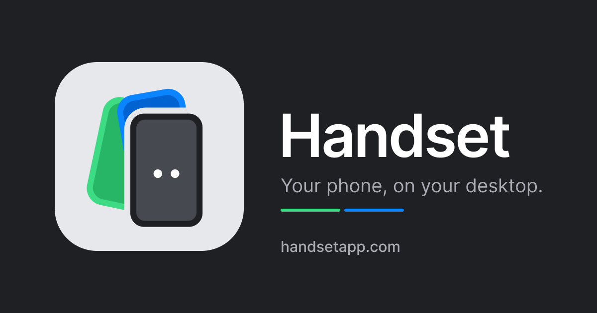
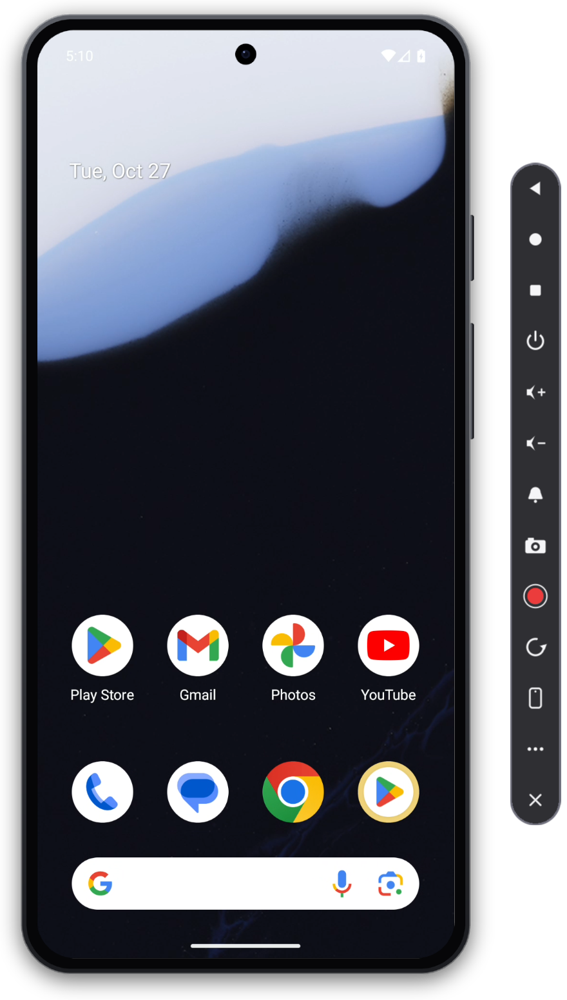
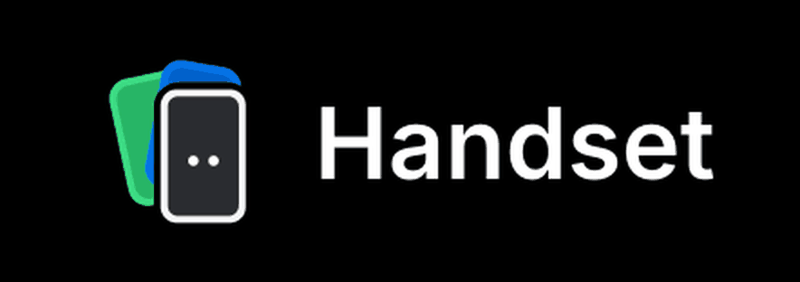

<p align="center"></p>

# Handset

[](https://github.com/davidamunga/handset/actions/workflows/ci.yml)

Mirror and control an Android phone from your Mac, inside a realistic device frame.

Handset is a small native Rust app. It talks to the unmodified
[scrcpy](https://github.com/Genymobile/scrcpy) server on the phone and replaces the desktop client,
so it can draw things a plain window cannot: phone bezels on a transparent window, a toolbar, and
framed screenshots and recordings with audio.

<p align="center"></p>

> **Status: early work in progress.** It works on the author's Mac with one phone. Expect rough edges.
> It has been tested on macOS and on Windows 11. Linux builds and is checked in CI, but has not been run on a
> real desktop yet (see [Linux](#linux-experimental)). iPhone and iPad mirroring is experimental and view only
> (see [iPhone and iPad](#iphone-and-ipad-experimental)).

**Contents:** [Install](#install) · [Connecting a phone](#connecting-a-phone) · [Features](#features) ·
[iPhone and iPad](#iphone-and-ipad-experimental) · [Options](#options) · [Updates](#updates) ·
[Building from source](#building-from-source) · [Troubleshooting](#troubleshooting) · [Roadmap](#roadmap) ·
[Contributing](#contributing)

## Install

On every platform you need:

- An Android phone with USB debugging enabled (audio needs Android 11 or later)
- [`adb`](https://developer.android.com/tools/releases/platform-tools) (Android platform-tools)
- [`ffmpeg`](https://ffmpeg.org) for recording (optional)

Releases are on the [releases page](https://github.com/davidamunga/handset/releases); check a download against
the release's `SHA256SUMS` if you like.

### macOS

macOS 12 or later, on Apple Silicon or Intel. With [Homebrew](https://brew.sh) (installs the signed, notarised
app, the `handset` command, and the `adb` and `ffmpeg` it needs):

```sh
brew install --cask davidamunga/tap/handset
```

Recent Homebrew versions only load casks from third-party taps you have trusted. If it says the tap is
not trusted, run `brew trust davidamunga/tap` and install again.

Or download `Handset-<version>-macos.zip` from the releases page, unzip it and move `Handset.app` to
Applications. The zip is a universal build (Apple Silicon and Intel). Install `adb` yourself in that case
(`brew install --cask android-platform-tools`), and `ffmpeg` if you want recordings.

### Windows

Windows 10 or 11. With [Scoop](https://scoop.sh) (this repository is the bucket, and `adb` comes with it):

```sh
scoop bucket add handset https://github.com/davidamunga/handset
scoop install handset/handset
```

Or download `Handset-<version>-windows.zip` from the releases page, unzip it and run `handset.exe`.
The build is not code-signed yet, so SmartScreen warns on first run (More info, Run anyway), and a PC
with Smart App Control turned on blocks it. Install `adb` (`winget install Google.PlatformTools`) and
`ffmpeg` for recordings (`winget install Gyan.FFmpeg`); the app finds both without any setup.

`adb` and `ffmpeg` are found on `PATH`, in the Android SDK (`%LOCALAPPDATA%\Android\Sdk\platform-tools`), in
winget, scoop or Chocolatey shims, or next to `handset.exe` (also in a `platform-tools` folder there). Set `ADB`
or `FFMPEG` to override. Captures go to `Pictures\handset` and `Videos\handset`; settings live in
`%USERPROFILE%\.config\handset`. Only the Dock icon states are macOS-only.

### Linux (experimental)

It builds and passes its tests on Ubuntu 22.04 in CI, but nobody has run the window on a Linux desktop yet, so
expect problems with the transparent, borderless frame on some compositors. There is no download yet; install it
from source with Cargo. You need Rust 1.91 or newer, `cmake`, `nasm` and the ALSA headers.

Arch, Omarchy, EndeavourOS and Manjaro:

```sh
sudo pacman -S --needed base-devel cmake nasm alsa-lib android-tools rust zenity
cargo install --git https://github.com/davidamunga/handset --locked handset
```

Debian and Ubuntu (install Rust with [rustup](https://rustup.rs): the Rust in Ubuntu 22.04 and Debian 12 is too old):

```sh
sudo apt install build-essential pkg-config cmake nasm libasound2-dev adb zenity
cargo install --git https://github.com/davidamunga/handset --locked handset
```

That puts `handset` in `~/.cargo/bin` (put that on your `PATH`). Run `handset --doctor` to check your setup, then
`handset --audio`. Run the same `cargo install` command with `--force` to update. This does not add a launcher
entry: copy `app/packaging/linux/handset.desktop` and `app/packaging/icon/handset-icon-512.png` into
`~/.local/share/applications` and `~/.local/share/icons/hicolor/512x512/apps/handset.png` if you want one.

At run time, `adb` and `ffmpeg` are found on `PATH`, in `~/.local/bin` or in `~/Android/Sdk/platform-tools`.
Your user needs USB access to the phone (udev rules for Android, usually the `plugdev` group or the
`android-udev-rules` package). Captures go to `~/Pictures/handset` and `~/Videos/handset`. There is no
right-click menu yet; the toolbar and the keyboard shortcuts work.

Optional helpers (`handset --doctor` lists any that are missing and says what to install):

- `xdg-open`: open links and captures
- `wl-clipboard` on Wayland or `xclip`/`xsel` on X11: the clipboard and "copy capture"
- `zenity` or `kdialog`: the address prompt and error dialogs. A stock Omarchy has no `zenity`, so the address
  and pairing-code prompts do nothing until you `pacman -S zenity`.

File dialogs go through the desktop portal (`xdg-desktop-portal` with a backend for your desktop), not GTK.
On a tiling compositor such as Hyprland, float the window or it is tiled to fit. The class is `handset` on Wayland
and X11, and Hyprland's rule syntax differs by version: `windowrulev2 = float, class:^(handset)$` on older ones,
`windowrule = float on, match:class ^(handset)$` on newer ones (check `hyprctl version` and the Hyprland wiki).

Which systems:

- **Ubuntu 22.04 and newer, Debian 12 and newer, Fedora, and other glibc systems at least that new:** the CI tarball
  needs glibc 2.35 (`scripts/package-linux.sh` refuses to build one that needs more) and ALSA (`libasound2`). On
  older systems (Ubuntu 20.04, Debian 11) build from source.
- **Arch and its derivatives (Omarchy, EndeavourOS, Manjaro):** besides `cargo install`,
  `app/packaging/linux/PKGBUILD` builds a package from a release tag (`makepkg -si`; not on the AUR yet).
- **Alpine (musl):** build from source with a dynamic link, because Handset loads the window and GPU libraries at
  run time and a static musl binary cannot: `apk add build-base cmake nasm pkgconf alsa-lib-dev rustup`, then
  `RUSTFLAGS='-C target-feature=-crt-static' cargo build --release` in `app`. No prebuilt file for musl.
- **NixOS:** see `app/packaging/nix/package.nix` (needs a nixpkgs with Rust 1.91 or newer).
- **Flatpak and Snap are not supported yet**: both sandboxes make `adb` over USB and mDNS harder, and they
  cannot be built or tested here (see `docs/adr/0032-support-older-glibc-musl-and-nix-and-leave-out-flatpak-and-snap.md`).

## Connecting a phone

With no phone connected, Handset opens on a connect screen inside the frame. It watches adb, says what it sees
(nothing yet, a phone waiting for you to tap Allow, an offline connection) and starts mirroring by itself as soon
as a phone is ready. While it looks for a phone, the eyes in the logo glance about.

<p align="center"></p>

<p align="center">
  
  
  
</p>

- **USB:** the steps on the home screen update as you plug the phone in.
- **Wi-Fi** lists paired phones found on your network (tap one to connect), asks for an address if you
  want to type one, and, when a phone is plugged in, switches it to Wi-Fi so you can unplug the cable.
- **Reconnect to ...** appears on the home screen once you have used a phone over Wi-Fi, and the Wi-Fi view lists
  your recent phones, so a phone you used before is one click away.
- **QR code** shows a code to scan on the phone (Developer options, Wireless debugging, Pair device with
  QR code; Android 11 or later). Handset pairs with the phone that scans it and connects, with nothing to
  type.
- **Run checks** runs the same checks as `handset --doctor` and shows what to fix (a missing `adb`, a phone that has
  not authorised this computer, a sleeping screen) right in the frame.

With a pairing code, from the command line: on Android 11 or later, open Developer options > Wireless debugging >
Pair device with pairing code, run `handset --pair <ip:port> <code>` with what it shows, then
`handset --connect <ip:port>` with the address on the main Wireless debugging screen. On any version,
`handset --wifi` does it from a USB connection in one step. The phone and the Mac must be on the same network.

A running session has a **Phone** submenu (right-click): **Switch to Wi-Fi** for a USB phone, **Connect Another
Phone** and **Disconnect**. After Disconnect nothing restarts by itself; the connect screen offers the phone
that is plugged in, or the Wi-Fi and QR options.

## Features

- Live video and device audio over adb (USB), decoded in software and drawn with wgpu
- Twenty-one device frames (punch-hole, notch, island, tablet, foldable, flip, rugged and more, see
  [docs/frames.md](docs/frames.md)), or your own PNG, on a transparent window, switchable while running
- Touch, scroll, keyboard and text input; landscape rotation
- Framed screenshots (transparent PNG) and recordings (MP4 with audio, or GIF) via ffmpeg
- A style editor for captures (see [Styling captures](#styling-captures))
- A Dock icon that shows what Handset is doing: grey eyes while waiting for a phone, amber while connecting, white
  while mirroring, red with a dot while recording
- A toolbar beside the phone and a native right-click menu, with an **About Handset** item that credits the author
- Clipboard text is shared with the phone: copy on the phone and paste on the Mac, or copy on the Mac, click the
  Handset window and paste on the phone
- A clickable "saved" toast, a recent captures menu and automatic clipboard copy
- A single binary (under 20 MB, including the style editor) with the scrcpy server embedded

### Controls

- **Right-click** the phone, or use the toolbar beside it: Back, Home, Recents, Power, Volume, the notification
  shade, frames, **Open App**, screenshot, recording, recent captures, rotate, quit. Hover a toolbar button for
  its name. Open App lists the phone's apps (yours first, system apps in a submenu), fetched in the
  background a few seconds after the phone connects.
- **Shortcuts** (Cmd or Ctrl): `S` screenshot, `E` start or stop recording, `R` rotate the phone.
  `Esc` is Back, `Home` is Home, `End` is Recents.
- **Show Touches** (right-click menu, or `--show-touches`) draws a translucent dot where you touch the phone, fading
  when you let go. It is part of screenshots and recordings too, which makes demos easier to follow.
- **Drop a file** on the window: an `.apk` is installed, anything else is copied to the phone's Downloads folder.
- **Move** the window by dragging the bezel. **Resize** by dragging a corner of the phone (it keeps the frame's
  proportions), with Cmd or Ctrl and scroll, or `+`, `-` and `0` (default size), also in the menu.

### Screenshots and recordings

Screenshots are saved to `~/Pictures/handset`, recordings to `~/Movies/handset` (the folders on Windows and
Linux are under [Install](#install)), and both are copied to the clipboard. Click the toast to show the file in
Finder.

### Styling captures

Put a screenshot or recording on a gradient, wallpaper, colour or your own picture, with padding, shadow, rounded
corners and an aspect ratio (1:1, 16:9, 4:5 ...); trim and play recordings with sound; keep your own presets.
Your original is kept. Click **EDIT** on the toast after a capture is saved (or
**Recent Captures > Edit Style...**) to open the editor, or turn on
**Recording > Save a styled copy of each capture**. The guide is in [docs/styling.md](docs/styling.md).

## iPhone and iPad (experimental)

On macOS, Handset can also show an iPhone or iPad connected with a cable, with its sound. Plug it in while
the connect screen is open and click **Mirror iPhone (view only)**, or start it directly:

```sh
handset --ios --audio
```

It uses the same screen capture as QuickTime, so nothing is installed on the device and it does not need
developer mode. Unlock the device and tap **Trust** if it asks. The first time, macOS asks to let Handset use the
camera and microphone, because it treats the device's screen and sound as those. The frame, screenshots,
recordings and styling work as they do for Android phones. iOS shows a clean status bar (9:41, full signal
and battery) while it is captured.

For now it is:

- **macOS only.** Windows has no equivalent capture API.
- **USB only.** There is no Wi-Fi option. A plugged-in device is offered on the connect screen, never started by
  itself, so an iPhone that is only charging does not get in the way of an Android phone.
- **View only.** You cannot tap, type or press the device's buttons from Handset. The toolbar keeps only
  screenshot, record, next frame, menu and quit, the menu leaves out the phone's controls, and the frame list
  shows only the iPhone and iPad shapes.
  If you unplug the device, Handset saves any recording and goes back to the connect screen.

`--ios <name>` picks a device when several are connected. To open the app straight into this mode, put `--ios --audio`
in `~/.config/handset/args`. Why it works this way: [ADR 0025](docs/adr/0025-mirror-ios-devices-through-avfoundation-screen-capture.md).

## Options

| Option | What it does |
|---|---|
| `--frame <name\|path\|none>` | Built-in frame, your own PNG (with a `.frame` file), or no frame |
| `--max-size <px>` | Limit the video size (default 1920) |
| `--audio` | Capture the phone's audio and play it here |
| `--mute` | With `--audio`, record the audio but do not play it |
| `--gain <dB>`, `--no-normalize` | Recorded audio is normalised to about -16 LUFS; adjust or turn off |
| `--no-clipboard` | Do not copy captures to the clipboard |
| `--no-clipboard-sync` | Do not share clipboard text with the phone (also in the right-click menu) |
| `--no-update-check` | Do not look for a newer release this time (also **Check for Updates on Start** in the right-click menu) |
| `--version` | Print the version and quit |
| `--record-for <seconds>` | Record from the first frame, then quit |
| `--record-format mp4\|gif` | Recording format |
| `--record-size <px>` | Longest side of recordings (default 1280) |
| `--record-bg #rrggbb` | Recording background colour |
| `--style <look>` | The look used to style captures: a saved look's name (for example `"Aurora 16:9"`) or a style such as `"bg=gradient:dusk;padding=12;aspect=1:1"` (see [docs/styling.md](docs/styling.md)) |
| `--style-captures` | Save a styled copy beside each new screenshot and recording (also in the Recording menu) |
| `--restyle <file>` | Style a saved PNG, MP4 or GIF with `--style` (or your last look), print the new path and quit |
| `--edit [file]` | Open the style editor on a capture (a file dialog opens if you give none) |
| `--connect <ip[:port]>` | Connect to a phone over Wi-Fi (`adb connect`, default port 5555) and mirror it |
| `--last` | Reconnect to the phone you last used over Wi-Fi (Handset remembers the last few in `~/.config/handset/recent`) |
| `--pair <ip:port> <code>` | Pair with a phone using its Wireless debugging pairing code, then exit |
| `--verify-release <folder>` | Check downloaded release files against the signed `SHA256SUMS` and say whether they can be trusted |
| `--doctor` | Check `adb`, `ffmpeg` and each connected phone (authorised, online, Android version, screen on) and say what to fix; exits 1 when something blocks mirroring |
| `--wifi` | Switch a USB-connected phone to Wi-Fi, connect, and mirror (you can unplug the cable) |
| `--start-app <package>` | Open an app on the phone once it is mirrored, e.g. `--start-app com.android.chrome` (a leading `?` searches app names) |
| `--ios [name]` | Mirror an iPhone or iPad connected by USB instead of an Android phone (macOS, experimental, view only; see above) |
| `[serial]` | Pick a device when several are connected |

With no arguments, `~/.config/handset/args` is used if it exists. `HANDSET_DEBUG=1` prints diagnostics, and
`HANDSET_LANDING=wifi` or `qr` opens that view of the connect screen first. `ADB` and `FFMPEG` override where the
tools are found.

Choices made in the menus (frame, toolbar, touches, capture format, audio normalisation, clipboard copy and
sync, mute, styled copies of captures) are remembered in `~/.config/handset/settings`, a plain `key=value` file
you can edit. Command-line options win for the run they are given and are never saved.

## Updates

On every start, Handset asks GitHub whether a newer release exists and
shows a blue banner at the bottom of the phone and a green update button in the toolbar; click either to update,
or the banner's **X** to hide it for three days. **Check for Updates...** in the menu asks right away, and **Check for
Updates on Start** turns the automatic check off (or use `--no-update-check`, or `update-check=off` in the settings
file). The request goes to `api.github.com` through `curl` and carries only a `handset/<version>` User-Agent.

Handset knows how it was installed: with Homebrew, Scoop or winget the banner gives the command to run
(`brew upgrade --cask handset`, `scoop update handset`, `winget upgrade davidamunga.Handset`) and a click
copies it, so the package manager stays in charge. A downloaded app (macOS) or unzipped release (Windows) can
install the update itself: it checks the release's signature and checksum, replaces the app and restarts, and puts the
old one back if anything fails. The menu also offers **What's New**, **Skip** (that version stays quiet) and **Remind
Me in 3 Days**. There is no in-place update on Linux: run `cargo install` again with `--force`.

How it works: [docs/updates.md](docs/updates.md).

## Building from source

You need Rust (stable; on Linux 1.91 or newer and the build packages under [Linux](#linux-experimental)).

```sh
git clone https://github.com/davidamunga/handset.git
cd handset/app
cargo run --release -- --audio
```

To install the command line tool instead: `cargo install --path app --locked`.

**macOS:** build the app bundle and open it:

```sh
scripts/package-macos.sh
open dist/Handset.app
```

A bundle you build yourself is ad-hoc signed, so the first time you may need to right-click it and
choose Open (the released app is signed and notarised and does not).

**Windows:** build with `cargo rustc --release --bin handset -- -C link-arg=packaging/windows/handset.res` in `app`
(plain `cargo build --release` also works, but the `.exe` file then has no icon); the binary is
`app\target\release\handset.exe`. `scripts\package-windows.ps1` builds `dist\windows\Handset-<version>-windows.zip`
(unsigned; pass `-ToolsDir` to bundle `adb` and `ffmpeg`).

**Linux:** run `cargo build --release` in `app`; the binary is `app/target/release/handset`.
`scripts/package-linux.sh` builds `dist/linux/Handset-<version>-linux-<arch>.tar.gz` (the binary, a
`handset.desktop` entry, the icon and the licences) and, when `appimagetool` is installed, an AppImage; CI
attaches the tarball to each run. Neither is part of a release yet, and neither bundles ALSA, so it must be
installed.

### How it works

adb forwards a port to the scrcpy server on the phone. Handset reads the video, audio and control
sockets, decodes H.264 on a video thread, converts and draws the frame on the GPU, and writes touch and key
messages straight back. The reasons behind each choice are in [docs/adr](docs/adr); procedures for
rebuilding the server, releasing and debugging are in [docs/runbooks](docs/runbooks).

## Troubleshooting

Run `handset --doctor`. It checks `adb`, `ffmpeg` and each connected phone (authorised, online, Android version,
screen on), says what to fix, and exits 1 when something blocks mirroring; on Linux it also lists missing optional
helpers. **Run checks** on the connect screen shows the same checks in the frame. `HANDSET_DEBUG=1` prints
diagnostics.

## Roadmap

Ideas, not promises:

- Keyboard-to-touch mapping profiles (a long-standing request in the scrcpy world)
- A device picker
- OBS-friendly output (Syphon or a virtual camera)
- Microphone to phone
- A Linux release (AppImage) and a right-click menu there
- Touch control for iPhone and iPad

## Contributing

See [CONTRIBUTING.md](CONTRIBUTING.md) and [AGENTS.md](AGENTS.md). Please use Conventional Commits.

## Credits and license

Handset embeds the scrcpy server by Genymobile and Romain Vimont (Apache-2.0); see [NOTICE](NOTICE).
Handset is not affiliated with Genymobile. Licensed under Apache-2.0, see [LICENSE](LICENSE).
