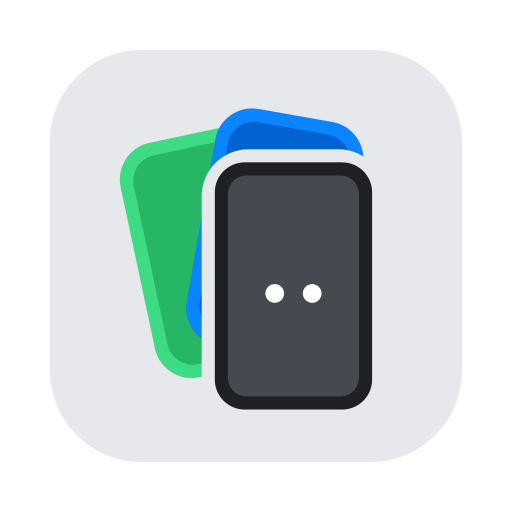
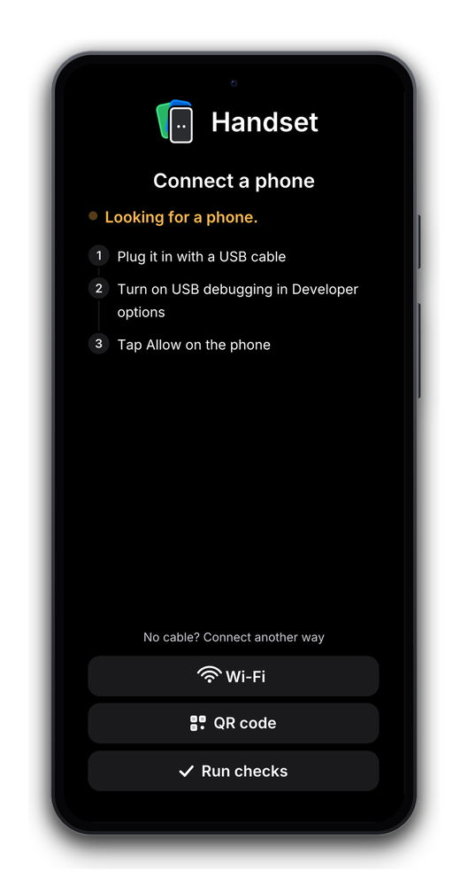
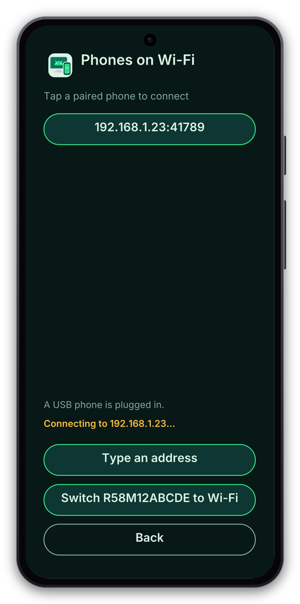
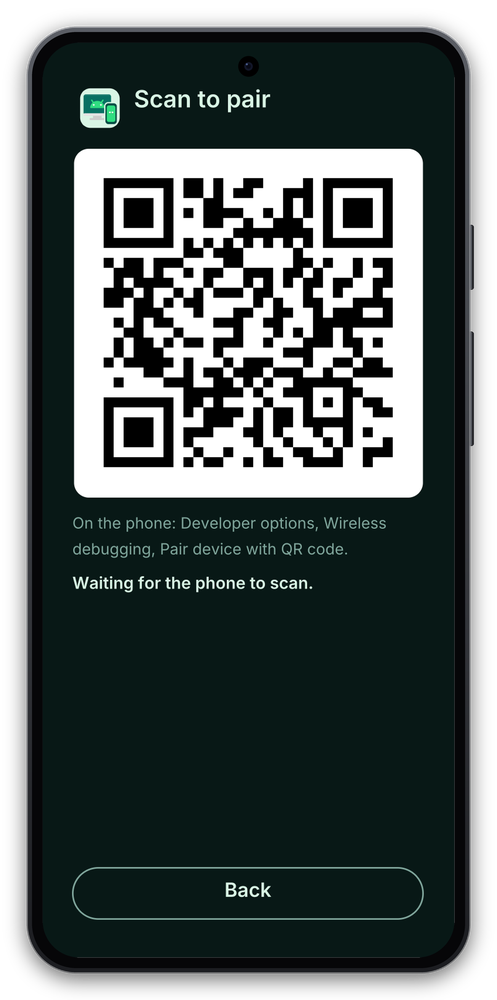

<p align="center"></p>

# Handset

[](https://github.com/davidamunga/handset/actions/workflows/ci.yml)

Mirror and control an Android phone from your Mac, inside a realistic device frame.

Handset is a small native Rust app. It talks to the unmodified
[scrcpy](https://github.com/Genymobile/scrcpy) server on the phone and replaces the desktop client,
so it can draw things a plain window cannot: phone bezels on a transparent window, a toolbar, and
framed screenshots and recordings with audio.

> **Status: early work in progress.** It works on the author's Mac with one phone. Expect rough edges.
> macOS is the only platform that has been tested.

## What it looks like

With no phone connected, Handset opens on a connect screen inside the frame: USB steps that update as you plug in,
and Wi-Fi and QR code options for connecting without a cable.

<p align="center">
  
  
  
</p>

## Features

- Live video and device audio over adb (USB), decoded in software and drawn with wgpu
- Realistic phone frames (`obsidian`, `porcelain`, `hazel`, or your own PNG) on a transparent window,
  switchable while running
- Touch, scroll, keyboard and text input; landscape rotation
- Framed screenshots (transparent PNG) and recordings (MP4 with audio, or GIF) via ffmpeg
- A toolbar beside the phone and a native right-click menu
- A clickable "saved" toast, a recent captures menu and automatic clipboard copy
- A small binary (about 5 MB) with the scrcpy server embedded

## Install

With [Homebrew](https://brew.sh) (installs the signed, notarised app, the `handset` command, and the
`adb` and `ffmpeg` it needs):

```sh
brew install --cask davidamunga/tap/handset
```

Recent Homebrew versions only load casks from third-party taps you have trusted. If it says the tap is
not trusted, run `brew trust davidamunga/tap` and install again.

Or download `Handset-<version>-macos.zip` from the
[releases page](https://github.com/davidamunga/handset/releases), unzip it and move `Handset.app` to
Applications. The zip is a universal build (Apple Silicon and Intel). Check it against `SHA256SUMS` if you
like. Install `adb` yourself in that case (`brew install --cask android-platform-tools`), and `ffmpeg` if
you want recordings.

## Requirements

- macOS 12 or later, on Apple Silicon or Intel
- An Android phone with USB debugging enabled (audio needs Android 11 or later)
- [`adb`](https://developer.android.com/tools/releases/platform-tools) (Android platform-tools)
- [`ffmpeg`](https://ffmpeg.org) for recording (optional)
- Rust (stable) to build from source

## Build and run from source

```sh
git clone https://github.com/davidamunga/handset.git
cd handset/app
cargo run --release -- --audio
```

Or build the app bundle and open it:

```sh
scripts/package-macos.sh
open dist/Handset.app
```

A bundle you build yourself is ad-hoc signed, so the first time you may need to right-click it and
choose Open (the released app is signed and notarised and does not). To install the command line tool
instead: `cargo install --path app --locked`.

## Using it

- **Right-click** the phone, or use the toolbar beside it: frames, screenshot, recording, recent
  captures, rotate, quit.
- **Shortcuts** (Cmd or Ctrl): `S` screenshot, `E` start or stop recording, `R` rotate the phone.
  `Esc` is Back, `Home` is Home, `End` is Recents.
- **Move** the window by dragging the bezel. **Resize** with Cmd or Ctrl and scroll.
- Screenshots are saved to `~/Pictures/handset`, recordings to `~/Movies/handset`, and both are copied to
  the clipboard. Click the toast to show the file in Finder.

## Options

| Option | What it does |
|---|---|
| `--frame <name\|path\|none>` | Built-in frame, your own PNG (with a `.frame` file), or no frame |
| `--max-size <px>` | Limit the video size (default 1920) |
| `--audio` | Capture the phone's audio and play it here |
| `--mute` | With `--audio`, record the audio but do not play it |
| `--gain <dB>`, `--no-normalize` | Recorded audio is normalised to about -16 LUFS; adjust or turn off |
| `--no-clipboard` | Do not copy captures to the clipboard |
| `--record-for <seconds>` | Record from the first frame, then quit |
| `--record-format mp4\|gif` | Recording format |
| `--record-size <px>` | Longest side of recordings (default 1280) |
| `--record-bg #rrggbb` | Recording background colour |
| `--connect <ip[:port]>` | Connect to a phone over Wi-Fi (`adb connect`, default port 5555) and mirror it |
| `--last` | Reconnect to the phone you last used over Wi-Fi (Handset remembers the last few in `~/.config/handset/recent`) |
| `--pair <ip:port> <code>` | Pair with a phone using its Wireless debugging pairing code, then exit |
| `--wifi` | Switch a USB-connected phone to Wi-Fi, connect, and mirror (you can unplug the cable) |
| `[serial]` | Pick a device when several are connected |

With no phone plugged in, Handset opens on a "connect a phone" screen inside the frame. It watches adb,
says what it sees (nothing yet, a phone waiting for you to tap Allow, an offline connection) and starts
mirroring by itself as soon as a phone is ready. Two buttons cover connecting without a cable:

- A running session has a **Phone** submenu (right-click): **Switch to Wi-Fi** for a USB phone, **Connect Another
  Phone** and **Disconnect**. After Disconnect nothing restarts by itself; the connect screen offers the phone
  that is plugged in, or the Wi-Fi and QR options.
- **Wi-Fi** lists paired phones found on your network (tap one to connect), asks for an address if you
  want to type one, and, when a phone is plugged in, switches it to Wi-Fi so you can unplug the cable.
- **Reconnect to ...** appears on the home screen once you have used a phone over Wi-Fi, and the Wi-Fi view lists
  your recent phones, so a phone you used before is one click away.
- **QR code** shows a code to scan on the phone (Developer options, Wireless debugging, Pair device with
  QR code; Android 11 or later). Handset pairs with the phone that scans it and connects, with nothing to
  type.

Over Wi-Fi: on Android 11 or later, open Developer options > Wireless debugging > Pair device with pairing
code, run `handset --pair <ip:port> <code>` with what it shows, then `handset --connect <ip:port>` with the
address on the main Wireless debugging screen. On any version, `handset --wifi` does it from a USB
connection in one step. The phone and the Mac must be on the same network.

With no arguments, `~/.config/handset/args` is used if it exists. `HANDSET_DEBUG=1` prints diagnostics, and `HANDSET_LANDING=wifi` or `qr` opens that view of the connect screen first.
`ADB` and `FFMPEG` override where the tools are found.

## How it works

adb forwards a port to the scrcpy server on the phone. Handset reads the video, audio and control
sockets, decodes H.264 on a video thread, converts and draws the frame on the GPU, and writes touch and key
messages straight back. The reasons behind each choice are in [docs/adr](docs/adr); procedures for
rebuilding the server, releasing and debugging are in [docs/runbooks](docs/runbooks).

## Roadmap

Ideas, not promises:

- Keyboard-to-touch mapping profiles (a long-standing request in the scrcpy world)
- Wireless pairing, a device picker and a connection "doctor" that explains common failures
- OBS-friendly output (Syphon or a virtual camera)
- Back, Home and Recents on the toolbar, and saved settings
- Microphone to phone, Linux and Windows

## Contributing

See [CONTRIBUTING.md](CONTRIBUTING.md) and [AGENTS.md](AGENTS.md). Please use Conventional Commits.

## Credits and license

Handset embeds the scrcpy server by Genymobile and Romain Vimont (Apache-2.0); see [NOTICE](NOTICE).
Handset is not affiliated with Genymobile. Licensed under Apache-2.0, see [LICENSE](LICENSE).
