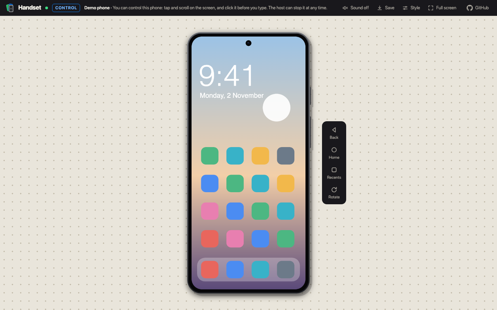
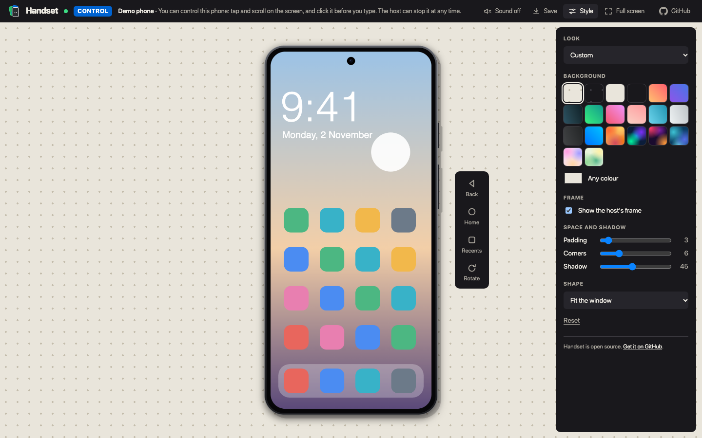
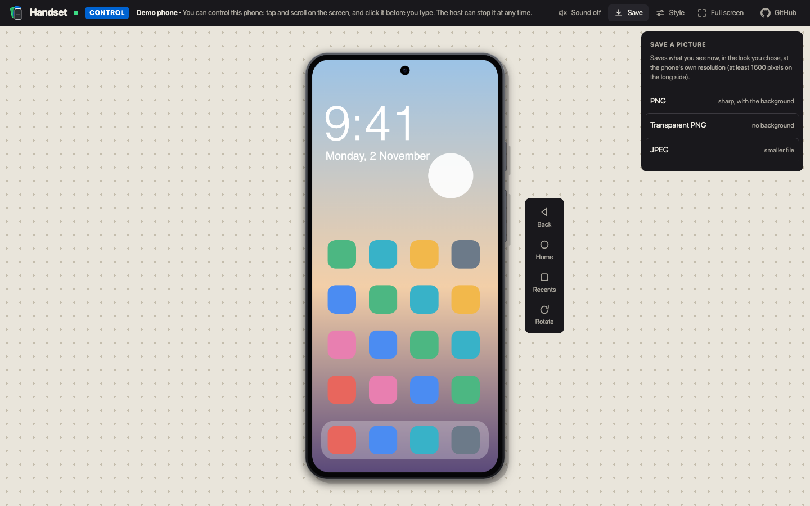

# Share in a browser

Let someone on the same network watch your phone, and tap on it if you allow it, from a web page. They install
nothing. The phone's video goes to their browser as it is, over WebRTC, so Handset does not re-encode it. The
reasoning is in [ADR 0039](adr/0039-share-the-phone-by-forwarding-its-h264-over-webrtc.md).

## Start sharing

1. Mirror an Android phone as usual. (An iPhone or iPad cannot be shared yet.)
2. Right-click the phone and choose **Share > Share in a Browser...**. The link is copied to the clipboard,
   replacing what was there. It looks like `http://192.168.1.71:8099/`.
3. Send the link to the other person. They open it in any recent browser on the same network.
4. A dialog on your computer asks what they may do. Choose one:
   - **Allow and Control**: they see the screen and can tap, swipe, scroll, type and press Back, Home and Recents
     and turn the phone.
   - **Watch Only**: they only see.
   - **Don't Allow**: they are told you did not let them in.

The pill on the phone says how many are watching and controlling. Each viewer's page says which it is: a "View only" or
"Control" badge in the header. A view-only viewer who taps the screen is told the host has not let them control it. **Share > Stop Sharing** ends every viewer, and
so does closing the window or disconnecting the phone. **Share > Copy Link** copies the link again.

## How the page looks

The page starts on a warm paper background with a grid of dots, and the phone fills the window. It draws the phone in the frame you chose in Handset (or without one if you chose none), on a background,
with the editor's own gradients and wallpapers. If you change the frame while people are watching, their page
follows. A phone on its side turns the frame with it.

Each viewer can change how it looks for themselves with **Style**: a look from the editor's presets, the
background (gradient, wallpaper or any colour), padding, corner radius, shadow, the shape of the page (1:1, 16:9,
4:5 and so on) and whether to show your frame. Their choices stay in their browser and do not change what other
viewers or you see. **Full screen** hides everything but the page.

**Save** downloads what the viewer sees as a PNG, a PNG with a transparent background, or a JPEG, at the phone's own
resolution (at least 1600 pixels on the long side). Anyone who can watch can save a picture, as they could with a
screenshot, so only allow people you would trust with one.

The header links to Handset's page on GitHub.

## Sound

Start Handset with `--audio`, or use **Turn On Audio**, before you share. Viewers then see a **Sound off**
button at the top right of the page. Browsers do not play sound until the person asks for it, so they click it.

## What viewers see

Everything on the phone's screen, including notifications and anything typed, and with sound, everything it
plays. With control they can open any app and do anything a finger can. Only allow people you know. The dialog and
the viewer's page say the same.

## Limits

- **Same network only.** Both devices must be on the same Wi-Fi or LAN, without client isolation, and not behind
  a VPN. Sharing across networks needs a service that does not exist yet (see the issue linked in the ADR).
- **Up to four viewers**, and three people waiting for an answer.
- **The link is plain HTTP.** The page and the connection setup are not encrypted; the video, sound and touches
  are. See [SECURITY.md](../SECURITY.md).
- **No bitrate adaptation.** A viewer that cannot keep up loses frames and picks up again at the next keyframe.
- **A refused address is not asked again** for 30 seconds, so someone cannot keep interrupting you.
- Handset asks before sharing from a computer that has a public internet address. It cannot tell a cafe's Wi-Fi
  from a home one, so on a network you do not trust, leave Share off.

## When it does not work

- **The link does not open on another device.** The devices are on different networks, a guest network or a
  VPN, or the router isolates clients. Try the link from the computer itself first: if that works, the problem is
  between the devices.
- **The page says the host did not let you in.** You chose Don't Allow, or clicked Don't Allow within the last
  30 seconds.
- **No sound button.** The phone is not sending sound. Audio needs Android 11 or later and Handset started with
  audio on.
- **Black picture in the browser.** Reload the page. Then check the log for `share:` lines
  (`HANDSET_DEBUG=1` adds more).

How the page and Handset talk to each other is written down in [share-protocol.md](share-protocol.md).
