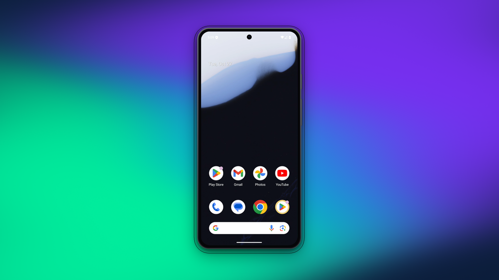
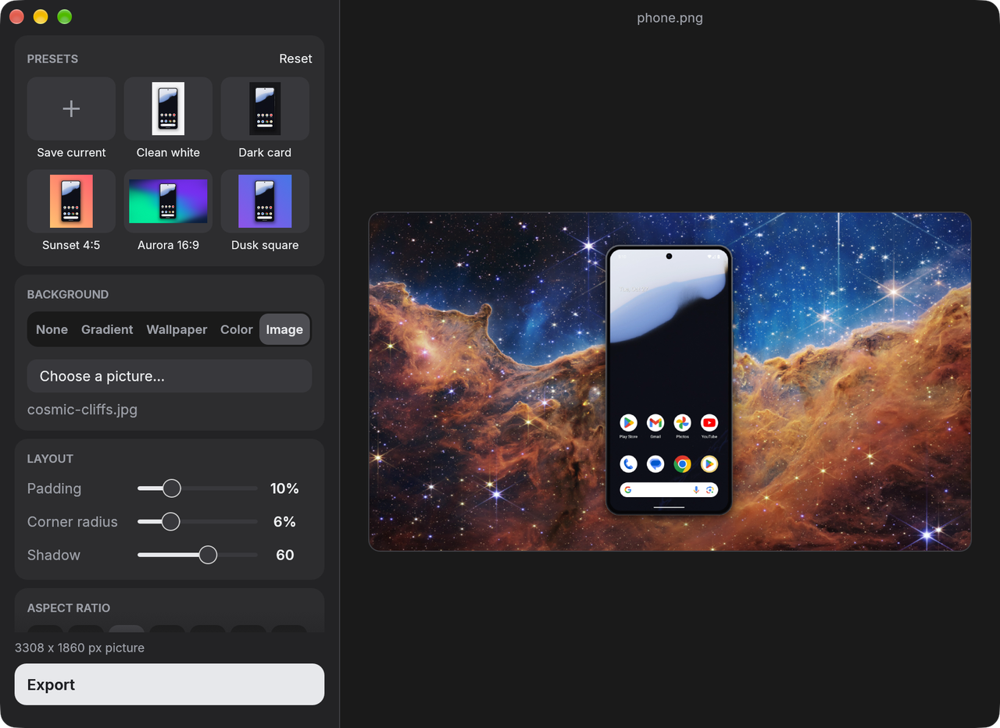

# Styling captures

Put a screenshot or recording on a background, with padding, a shadow, rounded corners and the shape you
want to post (square, 16:9, 4:5 and so on). It works for PNG screenshots and for MP4 and GIF recordings, and
the original file is never touched: the styled copy is saved beside it as `<name>-styled.<ext>`.

<p align="center">
  
</p>

Recordings need `ffmpeg`, as they do for recording itself. Screenshots do not.

## Ways to style a capture

- **From the toast.** After a screenshot or recording is saved, the toast reads `... SAVED - SHOW   EDIT`.
  Click **EDIT** to open the editor on that capture; click the left part to show it in Finder.
- **From the menu.** **Recent Captures > (a capture) > Edit Style...** opens the editor, and **Save Styled
  Copy** applies your last look straight away.
- **Automatically.** Turn on **Recording > Save a styled copy of each capture** (or run with
  `--style-captures`) and every new screenshot and recording gets a styled copy in the background.
- **From the command line.** `handset --edit [file]` opens the editor (it asks for a file if you give none),
  and `handset --restyle <file> --style <look>` styles a file and prints the new path.

## The editor

<p align="center">
  
</p>

The preview on the right is the capture as it will be exported. A change shows at once.

| Control | What it does |
|---|---|
| **Background** | **None** (transparent; recordings use a dark colour, as video cannot be transparent), **Gradient**, **Wallpaper**, **Color** (sixteen swatches and a colour picker) or **Image** (any picture you choose) |
| **Padding** | Space around the capture, 0 to 40 percent of its longer side |
| **Corner radius** | Rounds the capture's corners, 0 to 25 percent of its shorter side. A recording of a framed phone is cut out along the phone's own outline, so there is nothing to round and this control is hidden |
| **Shadow** | 0 to 100. The shadow follows the capture's outline |
| **Aspect ratio** | **Auto** (the capture plus its padding), 1:1, 16:9, 9:16, 4:5, 4:3 or 3:2. The short side is widened; the capture is never shrunk |
| **Presets** | Styles kept under a name, shown as thumbnails of your picture, and applied with one click (see below) |
| **Export** | Saves `<name>-styled.<ext>` beside the original and remembers the look for next time. A video export shows its progress and can be cancelled |

The size under **Export** is the size of the file you will get.

### Backgrounds

Everything is drawn by Handset, so nothing needs a licence:

- **Gradients:** `sunset`, `dusk`, `midnight`, `lagoon`, `candy`, `peach`, `ocean`, `mist`, `ink`, `bolt`.
- **Wallpapers** (soft colour blobs): `dune`, `aurora`, `ember`, `tide`, `orchid`, `meadow`.
- **Your own picture:** a PNG, or anything else `ffmpeg` can read (JPEG, WebP and most others). It is scaled to
  cover the whole background.

### Recordings

Under the preview of a recording there is a player.

- **Play and pause** with the round button or the space bar, and **drag the scrubber** to any moment.
  The preview plays the recording's sound too. **Sound** mutes it, and **Loop** repeats.
- **Trim** by dragging the two handles at the ends of the scrubber. Playback and Loop stay inside the
  kept part, and the exported file is cut to it, audio included. **Reset trim** brings the whole recording back.
  A clip cannot be shorter than 0.2 seconds.

The preview is a small, lower-quality copy so it stays smooth. The export is full quality (H.264, with the
audio copied as it is).

### Presets

The **Presets** card at the top of the editor shows styles kept under names, each drawn over your own picture.
A few come with Handset: `Clean white`, `Dark card`, `Sunset 4:5`, `Aurora 16:9` and `Dusk square`. Click one to
apply it. Click **Save current**, type a name and press **Save** to keep the current style; saving an existing name
replaces it. Yours have a small dot, and a right-click on one offers **Delete preset**. **Reset** goes back to the
default style. Yours are stored in `~/.config/handset/presets`, one `name<TAB>style` per line. Presets saved by an earlier version in
`~/.config/handset/looks` are picked up and moved there.

### Other things

- **Cmd or Ctrl + Z** undoes a change, and **Esc** closes the editor.
- **Drop a capture** on the editor to open it in a new editor window.
- The window cannot be made smaller or larger than a set range, so the controls always fit.

## On the command line

A look is written as a list of `key=value` pairs separated by `;`:

```text
bg=wallpaper:aurora;padding=12;radius=6;shadow=60;aspect=16:9
```

| Key | Values |
|---|---|
| `bg` | `none`, `color:#rrggbb`, `gradient:<name>`, `wallpaper:<name>` or `image:<path>` |
| `padding` | 0 to 40 |
| `radius` | 0 to 25 |
| `shadow` | 0 to 100 |
| `aspect` | `auto`, or a ratio such as `16:9` |

Anything you leave out keeps its default (`gradient:sunset`, padding 10, radius 6, shadow 60, aspect `auto`).
`--style` also takes the name of a look:

```sh
handset --restyle shot.png --style "bg=gradient:dusk;padding=12;aspect=1:1"
handset --restyle demo.mp4 --style "Aurora 16:9"
handset --edit demo.mp4
handset --style "Dark card" --style-captures --record-for 10
```

The last look you exported, or the `style` line in `~/.config/handset/settings`, is used when you do not give
one.

## Files

| File | What it is |
|---|---|
| `<name>-styled.<ext>` | The styled copy, next to the original (`-styled-2` and so on if you make several) |
| `<name>.matte` | Next to each recording: the outline of the framed phone, so the phone can be cut out of the recording's dark backdrop when it is styled. It is a small greyscale PNG. Handset removes the ones whose recording is gone |
| `~/.config/handset/presets` | Your saved presets |
| `~/.config/handset/settings` | `style=` (the last look) and `auto-style=` (styled copies of every capture) |

A recording made before styling existed has no `.matte`. It is styled as a rounded card on its own dark
backdrop instead of as a cut-out phone.

## Limits

- Video is styled by re-encoding it (H.264, quality 18), so it takes a little time; a long recording takes
  longer. GIFs are limited to 720 pixels wide.
- The preview's sound and picture agree to within a few tens of milliseconds, not frame by frame.
- A faint dark edge can remain on a phone cut out of a recording placed on a very light background.

How it works, and why, is in [ADR 0022](adr/0022-style-captures-with-a-shared-compositor.md).
